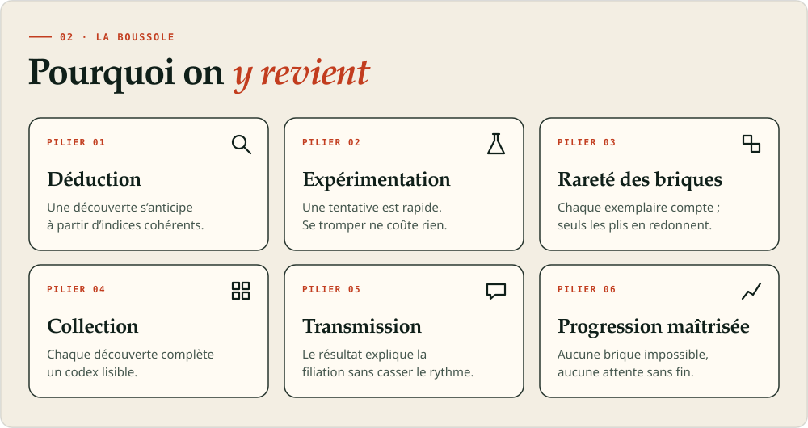
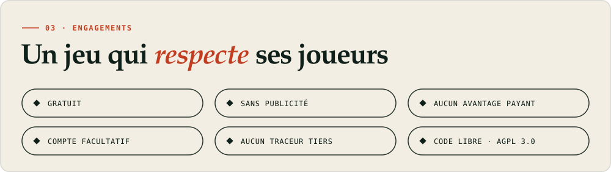
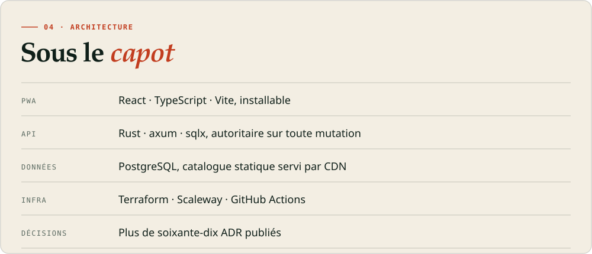
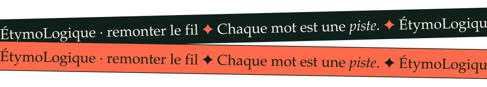

<a href="https://etymologique.fr"><picture><source media="(prefers-color-scheme: dark)" srcset="btn-jouer-nuit.svg"></picture></a>
<a href="https://ko-fi.com/lunik_tiwabbit"><picture><source media="(prefers-color-scheme: dark)" srcset="btn-kofi-nuit.svg"></picture></a>
<a href="https://lunik.github.io/EtymoLogique/"><picture><source media="(prefers-color-scheme: dark)" srcset="btn-dossier-nuit.svg"></picture></a>

**ÉtymoLogique** est un jeu de logique, de découverte et de collection. Vous posez deux briques (préfixes, suffixes, racines) sur la table de fusion. Si l’assemblage correspond à une recette étymologique documentée, le mot est révélé, expliqué, et rejoint votre codex.

<picture><source media="(prefers-color-scheme: dark)" srcset="jeu-nuit.svg"></picture>

Ce n’est ni un dictionnaire, ni un simulateur de concaténation : chaque recette repose sur un graphe de relations étymologiques dont chaque fait est sourcé. Une ressemblance de lettres ne fait pas une parenté.

<picture><source media="(prefers-color-scheme: dark)" srcset="piliers-nuit.svg"></picture>

Autour de la fusion : un fascicule de 20 à 30 mots environ tous les 30 jours, trois quêtes du jour, une carte de lecteur à tamponner, des ricochets pour réviser les cartes trouvées, et quelques légendaires, secrets, à dénicher.

<picture><source media="(prefers-color-scheme: dark)" srcset="respect-nuit.svg"></picture>

Code sous [AGPL 3.0](https://www.gnu.org/licenses/agpl-3.0.html), documentation et données sous [CC BY-SA 4.0](https://creativecommons.org/licenses/by-sa/4.0/deed.fr). On joue en invité ; le compte, facultatif, se crée par lien et code e-mail, sans mot de passe.

<picture><source media="(prefers-color-scheme: dark)" srcset="capot-nuit.svg"></picture>

Toutes les décisions sont publiées dans le [dossier de conception](https://lunik.github.io/EtymoLogique/adr.html).

<a href="https://ko-fi.com/lunik_tiwabbit"><picture><source media="(prefers-color-scheme: dark)" srcset="soutien-nuit.svg"></picture></a>

© 2026 Guillaume MARTINEZ · Le nom « ÉtymoLogique », le logo et la marque sont réservés.

